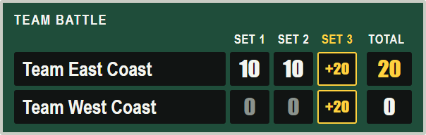
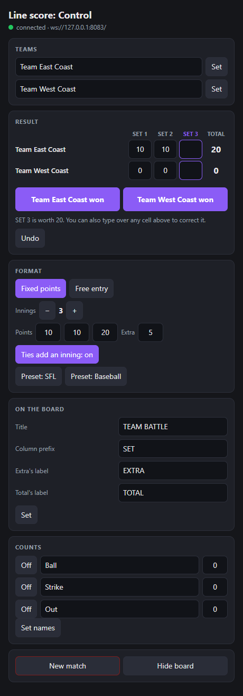
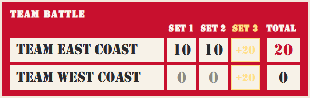
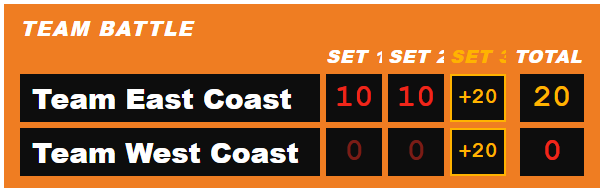

# Frames

**A Streamer.bot-native line score** for OBS, Streamlabs Desktop, XSplit, or any streaming app with a browser source: team names, a column per inning, and a total, driven from **Twitch chat**, a **Stream Deck**, **hotkeys**, or a small **browser control panel**. No dedicated server: Streamer.bot serves the overlay and holds the state.



It runs baseball-style scoring, where any team can score any number in any inning, and team formats like the Street Fighter League's, where each set is worth fixed points and a tie adds a tie-breaker. (A frame is baseball's word for an inning, and a fighting game's unit of time.)

| | |
|---|---|
| **Overlay** | the bundled **Ballpark** theme, with two CSS-only skins, or [your own](docs/THEMING.md) |
| **Scoring** | fixed points per inning with one-click winners, or free entry |
| **Ties** | another inning appears by itself, unless you turn that off |
| **Counts** | Ball, Strike and Out, each of which can be switched off or renamed |
| **State** | Streamer.bot global variables, which persist across restarts |
| **Control** | chat commands, Stream Deck, hotkeys, and `frames-shared/control.html` |
| **Needs** | Streamer.bot (built for 1.0.7) and a streaming app with a Chromium browser source. Node.js 18+ only for the no-Streamer.bot mock and the test suites |

## Quick start

First, get the code onto the machine that runs Streamer.bot, either with

```bash
git clone https://github.com/FlashGalatine/frames-linescore.git
```

or with **<> Code → Download ZIP** on the repo page, extracted somewhere. `<repo>` below means that folder.

1. **WebSocket Server:** Streamer.bot → *Servers/Clients → WebSocket Server*: enable, `127.0.0.1:8080`, authentication **off**. Frames doesn't speak Streamer.bot's authentication, like the other plugins in this family, so anything that can reach this port can run your actions. **Keep it bound to `127.0.0.1`**, never to a LAN address. (If the port is taken, run it elsewhere and add `?sbport=<port>` to every URL below.)
2. **HTTP Server:** *Servers/Clients → HTTP Server*: enable, `127.0.0.1:7474`, and add two Path → Folder mappings:

   | Path | Folder |
   |---|---|
   | `frames-themes` | `<repo>\frames-themes` |
   | `frames-shared` | `<repo>\frames-shared` |

3. **Two actions:** Actions → new action named **exactly** `Linescore Push`; add a sub-action *Core → C# → Execute C# Code*; paste [`actions/linescore-push.cs`](actions/linescore-push.cs); **Compile**. Repeat for `Linescore Command` with [`actions/linescore-command.cs`](actions/linescore-command.cs). Both compile with **no added references**. The names matter: panels run `Linescore Push` on connect, and `Linescore Command` runs it by name.
4. **Your streaming app:** add a Browser Source at its native size:

   ```
   http://127.0.0.1:7474/frames-themes/ballpark/panels/board-1200x260.html     (1200×260)
   ```

5. **Chat:** create a command `!ls` (Commands tab), and set its permission to **Moderators**. This is the only thing stopping any viewer from changing the board: the action trusts whoever Streamer.bot lets through. Add anyone else who should score, such as a tournament organizer, to the command's allowed users. Then, the step that's easy to miss, open the `Linescore Command` action and add a trigger: *Core → Commands → **Command Triggered***, then pick `!ls`. Not *Command Cooldown*, which sits right beside it and looks the same once it's added.
6. **Drive it:**

   ```
   !ls preset sfl
   !ls t1name Team East Coast
   !ls t2name Team West Coast
   !ls t1win
   ```

A panel added mid-match paints immediately, because on connect it asks Streamer.bot to re-broadcast the current state.

## Commands

Everything runs through the one parametric `Linescore Command` action. In chat, each of these follows `!ls`. Team tokens are `t1` (the top row) and `t2`.

| `command` | `value` | Effect |
|---|---|---|
| `t1win` `t2win` | none | Fixed points: that team wins the live inning and gets its points, the other team gets 0, and the live inning moves on |
| `undo` | none | Takes back the last scoring change, up to 20 steps. That includes `reset` and `preset`, which bring the old scores back, though not the old format |
| `t1` `t2` | `3 20` | Sets that team's inning 3 to 20. `3 -` clears the cell. Any number from 0 to 99 |
| `t1+` `t1-` `t2+` `t2-` | none | One point up or down in the live inning |
| `next` | none | Free entry: moves the live inning on, writing 0 into any blank cell |
| `t1name` `t2name` | text | Renames a team, exactly as typed |
| `innings` | number | The number of regular innings, 1 to 12 |
| `worth` | `10 10 20 x5` | Switches to fixed points, one value per inning, with `x` marking the extra's. This also sets the innings count |
| `free` | none | Switches to free entry |
| `extra` | `on` or `off` | Whether a tie adds another inning. With it off, a tie stands as a draw |
| `ball` `strike` `out` | `2`, `on`, `off`, `name Games` | Sets a count, shows or hides it, or renames it. Commands keep using the original word |
| `title` `collabel` `extralabel` `totallabel` | text | The board's title, the column prefix (`SET` gives SET 1), the extra's label and the total's label |
| `preset` | `sfl` or `baseball` | Applies a format, below. It clears the scores, keeps the team names, and shows the board if it was hidden |
| `reset` | none | A new match: clears the scores and the counts' values. Names, format and labels stay |
| `hide` `show` | none | Hides or shows the board |

There's one panel-only command, **`setmany`**, which applies several text fields in one call (`t1name`, `t2name`, `title`, `collabel`, `extralabel`, `totallabel`, `ballname`, `strikename`, `outname`), because Streamer.bot can bleed the arguments of two calls that land within a few milliseconds. Chat and Stream Deck never need it.

A rejected command changes nothing and logs a warning in **Streamer.bot → Logs**. It doesn't reply in chat.

**Chat styles.** Either the one dispatch command above (`!ls t1win`) or a dedicated command per action (`!t1win`, `!undo`…), each added as a trigger on `Linescore Command`.

**Stream Deck / hotkeys.** Make a wrapper action per button: *Set Argument* `command` = `t1win` → *Run Action* `Linescore Command`, and bind the key to the wrapper.

**Two people at once.** A `t1win` or `t2win` from chat is ignored if another win landed in the last 30 seconds, so two people typing the same result can't award two sets. Stream delay plus typing can put them that far apart, and a set takes minutes. `undo` and `next` work the same way, each against its own last use. To catch up from chat, set the cell directly with `t1 2 10`; an `undo` also clears the guard for the next result. A panel click is held to this only when the last one came from chat, so someone at the dock can't double up a moderator's result, while the panel's own clicks still land in order.

## Two ways to score

**Fixed points: a Street Fighter League style Team Battle.** `!ls preset sfl` sets three sets worth 10, 10 and 20, and a tie-breaker worth 5 if it's tied:

| | SFL | Baseball (a fresh install) |
|---|---|---|
| Mode | fixed | free |
| Innings | 3 | 9 |
| Points | 10, 10, 20; extra 5 | none |
| Column labels | SET 1, SET 2, SET 3, EXTRA | 1 … 9, then 10 … |
| Total's label | TOTAL | R |
| Title | TEAM BATTLE | blank |
| Ball / Strike / Out | off | on |

Run `!ls t1win` or `!ls t2win` as each set ends. At 20-20 the EXTRA column appears by itself. For a different format, use `!ls worth 5 5 10 10 x3`.

**Free entry: baseball.** Both teams can score in the same inning. Use `!ls t1+` or `!ls t1 3 2`, then `!ls next`. If the regular innings end level, another inning appears, up to the 12-column cap, where a tie stands as a draw.

## The control panel



Open **`http://127.0.0.1:7474/frames-shared/control.html`** in a browser tab, or in OBS add it as a **Custom Browser Dock**. It has team names, an editable grid, winner buttons, Undo, the format, the labels and New match. It drives the same `Linescore Command` over Streamer.bot's WebSocket and reflects live state, so it never fights chat or a Stream Deck.

- **It works on the streaming PC only.** Moderators and TOs elsewhere use chat.
- Edited but unsaved fields survive live updates. **Any Set click, or Enter in a text field, applies every edited field at once.**
- A double-click on any button counts once. Clicks on different buttons queue up and land in order.
- New match, and a preset when scores exist, take a second, separate click, in case you hit them by accident on air. Undo brings the scores back if you still meant not to.
- The buttons are disabled while the connection is down, and nothing clicked then is replayed when it comes back. Text you typed stays until you can Set it.
- A half-typed cell stays half-typed when a result arrives from chat, even one that adds a column. A box catches up with live state when you leave it, and a value Streamer.bot rejects goes back to the current one.
- While both names are still the defaults, the panel says that some themes stay hidden until real team names are set. Ballpark shows them; a theme like NFC's doesn't, so Show board can look like it did nothing.
- If the push action fails, its error appears in the status line until the next good update.

## Make it yours

Ballpark is one look. [docs/THEMING.md](docs/THEMING.md) covers the contract, a complete theme from scratch, and CSS-only reskins. Two ship with Ballpark: add `?skin=crosley` or `?skin=led` to the source's URL.




## Try it without Streamer.bot

```bash
npm install
```

```bash
npm start
```

`npm start` runs a small mock of Streamer.bot's two servers, so you can develop themes with no setup. Open `http://127.0.0.1:7474/` for the panels.

The test suites:

```bash
npm run verify
```

```bash
npm run verify:cs
```

```bash
npm i --no-save playwright-core
```

```bash
npm run verify:render
```

- `verify` runs the scoring rules and the transport against the mock.
- `verify:cs` (Windows) compiles the **real action files** with `csc.exe` against a fake `CPH`, and runs them through the same scenario table as the mock, so the two can't drift.
- `verify:render` runs the panel and the theme in Edge or Chrome.

The actions in `actions/` are generated: edit `actions/src`, then run `node tools/build-actions.mjs`.

## Troubleshooting

- **Chat command does nothing:** the command isn't a **trigger** on `Linescore Command`, the trigger is *Command Cooldown* rather than *Command Triggered* (the command then fires, but the action never runs, and Logs show no `[Linescore Command]` line), or its text doesn't match what you type. A message from Streamer.bot's bot account is also ignored if the command has Ignore Bot Account ticked, and on a channel where the bot and the broadcaster are one account, that means the broadcaster too. Streamer.bot → Logs shows `[Linescore Command] token='…'` for every hit, and `ignored: …` with the reason when a command is refused.
- **`!ls t1win` was ignored:** the board is in free entry, the match is over, or another win landed under 30 seconds ago. Logs says which.
- **A viewer could change the board:** `!ls` isn't set to Moderators. See step 5.
- **Panels blank:** state never arrived. Check the WebSocket Server is on `:8080` with authentication off (or that the URL carries a matching `?sbport=`), and that the action is named exactly `Linescore Push` and **compiles**. A compile error broadcasts nothing. On a runtime failure, the action broadcasts `{ type: 'linescore:error', message }`, and the control panel shows the message in its status line. Ballpark shows nothing at all until its first state arrives.
- **The board stayed hidden:** someone ran `hide`, which survives New match and a restart. Run `!ls show`, or any `preset`. Some themes also stay hidden until real team names are set, and the panel says so while both are still the defaults.
- **`npm start` fails with `EADDRINUSE`:** real Streamer.bot already owns the ports. Relocate the mock with `SB_HTTP_PORT=7480 SB_WS_PORT=8090 npm start`, or just use Streamer.bot.

## Author & support

Built by **Ashe "Flash" Galatine**.

- Email: [AsheJunius@gmail.com](mailto:AsheJunius@gmail.com)
- X: [@AsheJunius](https://x.com/AsheJunius) · BlueSky: [@projectgalatine.com](https://bsky.app/profile/projectgalatine.com)
- Twitch: [FlashGalatine](https://www.twitch.tv/FlashGalatine) · Discord: [Project Galatine](https://discord.gg/K6pRfSvu2Q)
- Support: Patreon [ProjectGalatine](https://www.patreon.com/ProjectGalatine) · CashApp [$ProjectGalatine](https://cash.app/$ProjectGalatine)

## Credits & license

MIT: see [LICENSE](LICENSE). The transport and the action calling styles are adapted from [Tally](https://github.com/FlashGalatine/tally-scorebug) (same author, MIT). Nothing third-party ships in this repository: Ballpark uses system fonts.
